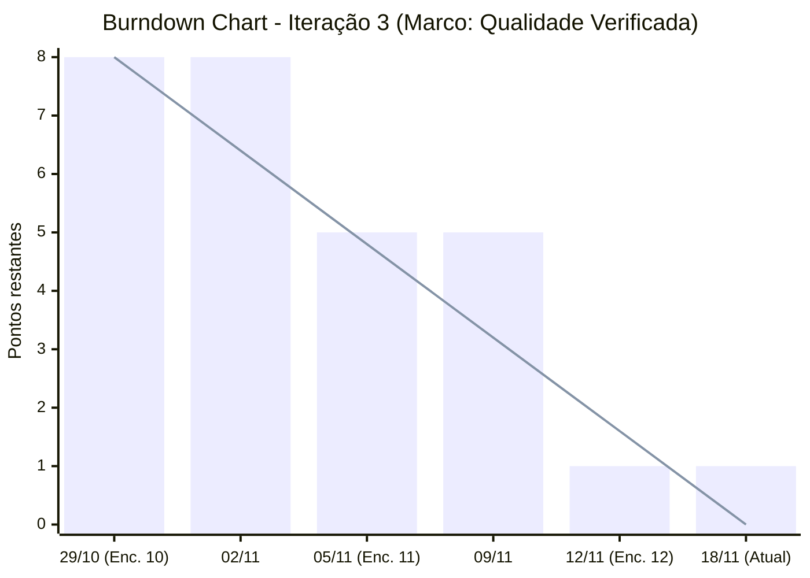

# Iterações

## Iteração 4 — Planejamento Semanal (Evolução — Cap. 15 e 16)

- **Cadência de prazos:** Ciclos semanais de **segunda-feira a segunda-feira**.
  - **Ciclo em andamento (`Seg 16/11` a `Seg 23/11`):** `DT-03` (Arthur), `HU-04` (Samuel) e fechamento/revisão do Marco 3 (`Cap. 12`, Luis).
  - **Próximo ciclo (`Seg 23/11` a `Seg 30/11`):** `HU-03+` (Arthur), `DT-01` (Arthur) e consolidação final (`Cap. 16`, Luis).

| Item | Pontos | Responsável principal | Prazo (Segunda a Segunda) |
| --- | ---: | --- | --- |
| `DT-03` Treino multiexercício, autocomplete, sessão anterior e CRUD | 2 | Arthur Sidarta | Ciclo atual (`16/11` a `23/11`) |
| `HU-04` Gráfico de evolução (`Carga Máxima`, `1RM` Epley, `Volume Total`) e filtros | 2 | Samuel Andrade | Ciclo atual (`16/11` a `23/11`) |
| `Cap. 12` Revisão final e conferência cruzada do Marco 3 | 1 | Luis Henrique | Ciclo atual (`16/11` a `23/11`) |
| `HU-03+` Painel semanal de água/sono, sono decimal/cochilo, desfazer e modal de metas | 2 | Arthur Sidarta | Próximo ciclo (`23/11` a `30/11`) |
| `DT-01` Extrair camada de consultas SQLite do `main.py` para módulo próprio | 2 | Arthur Sidarta | Próximo ciclo (`23/11` a `30/11`) |
| `Cap. 16` Conferência cruzada final e roteiro da Review Final | 1 | Luis Henrique | Próximo ciclo (`23/11` a `30/11`) |

---

## Iteração 3 (Encontros 10 a 12 — Marco: Qualidade Verificada)

- **Meta:** Implementar o acompanhamento de metas de água e sono (`HU-03`), estruturar a verificação e validação (`TESTES.md`), registrar e controlar dívida técnica, e ativar a suíte de testes automatizados (`pytest`) e integração contínua (`GitHub Actions`).
- **Capacidade:** 3 integrantes (6 pontos de funcionalidades/testes + 2 pontos de reserva técnica = 8 pontos).

| Item | Pontos | Responsável principal | Necessário para o Marco 3 |
| --- | ---: | --- | --- |
| `HU-03` Cadastrar e atualizar progresso de metas de água e sono (`META`) | 3 | Arthur Sidarta | Sim |
| `Cap. 10` Lista de verificação de revisão, template de PR, GQM e dívida técnica | 1 | Luis Henrique | Sim |
| `Cap. 11` Inspeção de requisitos e criação do `TESTES.md` (partições e limites) | 2 | Samuel Andrade | Sim |
| `Cap. 12` Suíte automatizada (`pytest`), estilo (`ruff`), CI e revisão dos `TCs` | 2 | Arthur Sidarta / Luis Henrique | Sim |

### Burndown Chart — Iteração 3

Diagrama em [`diagrams/burndown-iteracao3.mmd`](diagrams/burndown-iteracao3.mmd).

- **Barras (Real):** `[8, 8, 5, 5, 1, 1]` — acompanhamento pelos marcos de entrega no repositório (`7` de `8` pontos concluídos até `18/11`, restando apenas `1 pt` em revisão final por Luis):
  - `29/10 (Enc. 10)`: `8 pts` planejados no início da iteração.
  - `05/11 (Enc. 11)`: `5 pts` restantes após entrega de `HU-03` (`-3 pts`, commit `a374913`).
  - `12/11 (Enc. 12)`: `1 pt` restante após entrega de `Cap. 10` (`-1 pt`), `Cap. 11` (`-2 pts`) e suíte/CI de `Cap. 12` (`-1 pt`, commits `19c2f11` a `89a7d13`).
  - `18/11 (Atual)`: `1 pt` restante na conferência cruzada final do Marco 3 (`Cap. 12` em revisão no `QUADRO_TAREFAS.md`), com quadro Kanban em Mermaid e Burndown Chart atualizados para a apresentação.
- **Linha (Ideal):** `[8, 6.4, 4.8, 3.2, 1.6, 0]` — queima linear esperada dos 8 pontos planejados ao longo do ciclo.

### Dívidas Técnicas Registradas (Cap. 10)

| ID | Dívida | Origem | Custo de carregar | Custo de pagar | Gatilho | Reserva Iteração 3? |
| :--- | :--- | :--- | :--- | :--- | :--- | :---: |
| `DT-01` | Consultas SQLite e servidor HTTP no mesmo arquivo (`main.py`) | Atalho na Iteração 2 para agilizar a entrega da Review Parcial | 1 ponto extra por nova rota devido ao tamanho do arquivo | 2 pontos | Antes de adicionar autenticação (Cap. 13) | Não (planejada pós-Cap. 12) |
| `DT-02` | Caminho do banco `DB_PATH` fixo na conexão sem isolamento automático para testes | Pressa na construção inicial do banco SQLite | 1 ponto por bateria de teste (risco de sujar o banco local) | 1 ponto | Ao criar os testes de integração da API (Cap. 12) | **Sim (Paga na Iteração 3 via fixture `pytest`)** |
| `DT-03` | Formulário de treino restrito a 1 exercício por requisição na UI inicial | Simplificação do MVP para o Encontro 9 | 0,5 ponto ao testar histórico de treinos compostos | 2 pontos | Na etapa de evolução do sistema (Cap. 15) | Não |

### Observações da Review Parcial convertidas em itens (Pós-Encontro 9)

| Origem | Observação | Tipo | Item gerado / Critério (`Dado-Quando-Então`) | MoSCoW |
| :--- | :--- | :--- | :--- | :--- |
| Review Parcial (Professor) | Ao cadastrar metas diárias, o usuário precisa ver imediatamente o percentual atualizado ao beber um copo de água | Melhoria de HU | `CA-03.2`: Dado que o usuário possui meta de 2000 ml, quando registra +250 ml, então o progresso atualiza para 250 ml (13%) | Importante (*Should*) |
| Review Parcial (Colegas) | Mensagem de erro ao salvar série sem carga poderia deixar claro se o problema foi campo vazio ou valor $\le 0$ | Melhoria de usabilidade | Diferenciação das mensagens `"Dados incompletos."` e `"Dados inválidos."` no retorno `400` de `POST /api/treinos` | Obrigatório (*Must* — Concluído) |

---

## Iteração 2 (Encontros 8 a 9 — Preparação da Review Parcial)

- **Meta:** Entregar o fluxo principal (`HU-01` e `HU-02`) funcionando de ponta a ponta (interface, servidor Python e banco SQLite), com cálculo real de volume e recusa de dados incompletos.
- **Capacidade:** 3 integrantes (aprox. 8 pontos na iteração).

| Item | Pontos | Responsável principal | Necessário para a demonstração |
| --- | ---: | --- | --- |
| `HU-01` Registrar treino diário (banco SQLite e rota `POST /api/treinos`) | 3 | Arthur Sidarta | Sim |
| `HU-02` Calcular e exibir volume de treino ($\sum \text{rep} \times \text{carga}$) | 2 | Samuel Andrade | Sim |
| Integração da tela (`prototipo/index.html`) com a API e tela de recusa | 2 | Arthur Sidarta / Samuel Andrade | Sim |
| Conferência cruzada (`PROJETO.md`, `ARQUITETURA.md`) e roteiro da Review | 1 | Luis Henrique | Sim |

---

## Iteração 1 (Encontros 6 a 8)

- **Meta:** Definir o modelo de domínio, banco de dados, protótipo navegável e estrutura da arquitetura web.
- **Planejado:** 6 pontos. **Concluído:** 6 pontos (`PROJETO.md`, diagramas Mermaid e protótipo do fluxo principal).

### Retrospectiva da Iteração 1

- **Evidências:** Pull requests `#8`, `#9`, `#10`, `#11` e `#12` integrados ao `main` com `Descoberta.md`, `Requisitos.md`, `PROJETO.md`, diagramas e protótipo HTML.
- **Leitura:** A divisão entre documentação de requisitos, diagramas e protótipo funcionou bem, mas alguns ajustes pequenos foram feitos diretamente no `main` no final da semana por falta de sincronia de horários.
- **Decisões de melhoria:**

| Mudança | Dono | Como conferir | Quando conferir |
| --- | --- | --- | --- |
| Conferência cruzada antes da entrega do marco | Luis Henrique | Tabela de conferência preenchida no `PROJETO.md` | Antes da Review Parcial (Encontro 9) |
| Limitar trabalho em andamento a 1 tarefa por pessoa | Arthur Sidarta | Quadro de tarefas (`QUADRO_TAREFAS.md`) sem acúmulo na coluna "Em revisão" | Retrospectiva da Iteração 2 |

- **Riscos revisados:**
  - `R1` (série salva sem carga distorcendo volume): mitigado com validação no frontend e retorno `400` no backend (`main.py`).
  - `R2` (escopo grande): `HU-03` (metas de água/sono) e `HU-04` (gráficos de evolução) mantidos para as iterações pós-review.

---

## Review parcial (Encontro 9)

- **Ambiente:** Execução local (`python main.py` em `http://localhost:5000`) com banco SQLite (`treinos.db`).
- **Limites e elementos simulados declarados:**
  - **Usuário:** Usuário de teste fixo (`id = 1`, perfil Marcos), pois autenticação não faz parte do escopo atual.
  - **Ambiente:** Servidor local, visto que a implantação externa será tratada no Capítulo 14.
  - **Itens fora desta demonstração (no backlog para as próximas iterações):** `HU-03` (metas de água e sono) e `HU-04` (gráficos de linha de evolução).

### Roteiro da demonstração

| Passo | Ação | O que o público vê | Critério comprovado |
| ---: | --- | --- | --- |
| 1 | Abrir a tela inicial da aplicação (`http://localhost:5000`) | Tela inicial com botão "Iniciar novo treino" e o histórico do último treino salvo no banco | `CA-01.3` |
| 2 | Clicar em "Iniciar novo treino", escolher "Supino reto", informar 3 séries (10 reps × 20 kg) e clicar em "Salvar treino" | O backend grava no SQLite, calcula o volume e exibe a tela "Treino salvo" com `600 kg` | `CA-01.1`, `CA-02.1` |
| 3 | Iniciar novo treino, apagar a carga de uma das séries (deixar vazio ou `0`) e tentar salvar | O sistema recusa o salvamento (`HTTP 400`) e exibe a tela de alerta "Dados incompletos" | `CA-01.2`, `CA-02.2` |
| 4 | Voltar para a tela inicial e atualizar a página (`F5`) | O treino recém-cadastrado permanece listado no histórico com data, exercício e volume total | `CA-01.3`, `CA-02.3` |

### Autoavaliação na data da Review Parcial

| Critério ou requisito | Status | Evidência |
| --- | --- | --- |
| `CA-01.1` Registrar treino (caminho principal) | Atendido | Rota `POST /api/treinos` em `main.py` e passo 2 do roteiro |
| `CA-01.2` Impedir salvamento com carga ausente (recusa) | Atendido | Validação no backend (`400`) e tela de erro no passo 3 do roteiro |
| `CA-01.3` Persistência dos treinos no histórico | Atendido | Tabelas SQLite em `treinos.db` e passo 4 do roteiro |
| `CA-02.1` Cálculo automático exato do volume | Atendido | Regra `RN-01` em `main.py` e exibição no resumo (passo 2) |
| `HU-03` Cadastrar metas diárias de água e sono | Concluído na Iteração 3 | Rotas `/api/metas` e `/api/metas/progresso` em `main.py` |
| `HU-04` Visualizar gráficos de progressão de cargas | Não iniciado | Planejado no backlog para a próxima iteração |
| `RNF-01` Privacidade (uso de usuário de teste sem dados civis) | Atendido | Esquema `USUARIO` em `diagrams/dados.mmd` e `main.py` |
