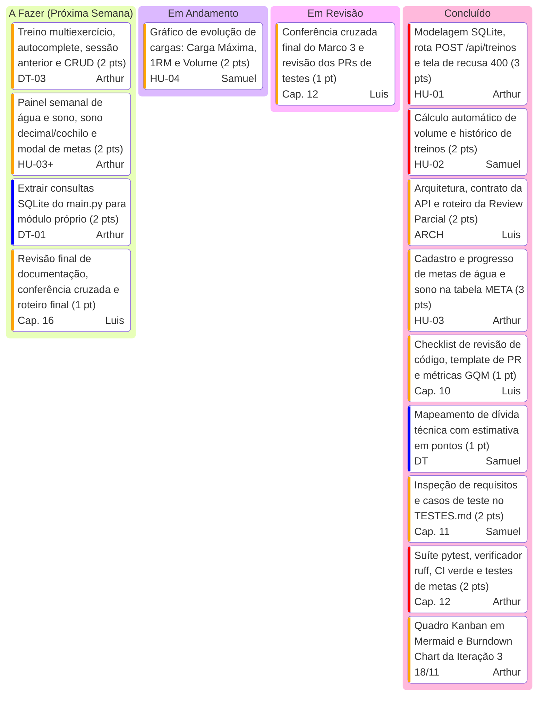

# Quadro de Tarefas (Kanban)

> **Projeto:** Plataforma de Hábitos Saudáveis e Treinos  
> **Equipe:** Arthur Sidarta, Luis Henrique, Samuel Andrade  
> **Política de WIP (Work in Progress):** Máximo de 1 tarefa ativa em andamento/revisão por integrante.  
> **Fonte do diagrama:** [`diagrams/quadro-tarefas.mmd`](diagrams/quadro-tarefas.mmd)

---

## Atualização Semanal (Apresentação 19/11 — Cap. 15 e 16)

### O que passou nesta semana (12/11 a 18/11)

- **Fechamento da Iteração 3 (Marco: Qualidade Verificada):**
  - Integração completa da `HU-03` (metas diárias de água e sono) e da suíte de testes automatizados (`pytest`) com verificador de estilo (`ruff`) e CI verde no GitHub Actions (`PR #14` e `PR #16` mesclados na `main`).
  - Expansão da suíte de testes de integração HTTP, contrato JSON de metas diárias (`CA-03.1` a `CA-03.3`) e planejamento semanal de entregas (`PR #15` e `PR #17` abertos para revisão).
  - Conversão do quadro de tarefas para o diagrama nativo `kanban` em Mermaid (`diagrams/quadro-tarefas.mmd`) e criação do **Burndown Chart** da Iteração 3 (`diagrams/burndown-iteracao3.mmd` e `ITERACOES.md`), restando `1 pt` em revisão final (`Cap. 12`).

### O que será feito na próxima semana (Iteração 4 — Evolução / Cap. 15 e 16)

- **`HU-04` (Gráficos de evolução de exercícios — Samuel Andrade):** evolução das sessões por exercício com seletor de métricas (**Carga Máxima**, **1RM Estimado** por Epley e **Volume Total**), filtros de período (`1M`, `3M`, `6M`, `Tudo`) e tooltips interativos.
- **`DT-03` (Treino completo e CRUD — Arthur Sidarta):** liberação de múltiplos exercícios por sessão, campo de busca com autocomplete, recuperação da última sessão do exercício e operações de editar/excluir treino.
- **`HU-03+` (Evolução de hábitos diários — Arthur Sidarta):** painel visual semanal de hidratação e sono (7 dias), registro decimal de sono com opção de cochilo, botão desfazer para hidratação e modal de configuração de metas.
- **`DT-01` (Dívida técnica — Arthur Sidarta):** extrair a camada de persistência SQLite do `main.py` para módulo próprio antes de iniciar o `Cap. 13`/etapas finais.
- **`Cap. 16` (Fechamento — Luis Henrique):** revisão final de documentação, conferência cruzada (`PROJETO.md`, `ARQUITETURA.md`, `ITERACOES.md`) e roteiro da apresentação final.

---

## Histórico de Atualização do Quadro

- **2026-09-17 (Iteração 1):** Criação do quadro com os itens de modelagem (`PROJETO.md`), diagramas e protótipo navegável.
- **2026-10-08 (Iteração 2):** Adoção do limite de WIP (1 tarefa por integrante) e acompanhamento da implementação de `HU-01` e `HU-02` para a Review Parcial.
- **2026-11-05 (Iteração 3):** Movimentação de `HU-01`/`HU-02` para Concluído, inclusão de `HU-03` e tarefas de qualidade e testes (Capítulos 10 a 12).
- **2026-11-18:** Conversão integral do quadro para Mermaid `kanban`, atualização semanal (o que passou e o que será feito na próxima semana — Cap. 15 e 16) e sincronização com a `main`.
