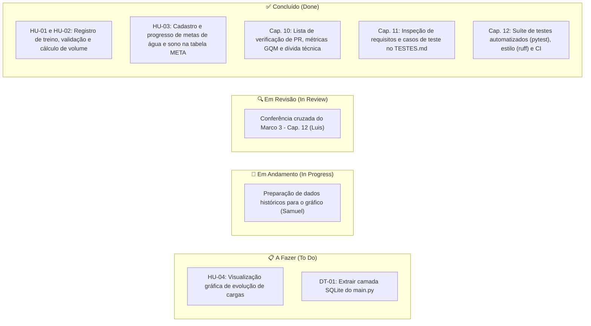

# Quadro de Tarefas (Kanban)

> **Projeto:** Plataforma de Hábitos Saudáveis e Treinos  
> **Equipe:** Arthur Sidarta, Luis Henrique, Samuel Andrade  
> **Política de WIP (Work in Progress):** Máximo de 1 tarefa ativa em andamento/revisão por integrante.

---

## Visualização Geral

---

## Status Detalhado por Tarefa

| ID / Etapa | Tarefa | Responsável | Estimativa | Status | Artefato / Evidência no Repositório |
| :--- | :--- | :--- | :---: | :---: | :--- |
| `HU-01` | Modelagem do banco SQLite, rota `POST /api/treinos` e tela de recusa (`400`) | Arthur Sidarta | 3 pts | **Concluído (Done)** | `CA-01.1`, `CA-01.2`, `CA-01.3` (`main.py` e `prototipo/index.html`) |
| `HU-02` | Cálculo automático de volume ($\sum \text{rep} \times \text{carga}$) e histórico | Samuel Andrade | 2 pts | **Concluído (Done)** | `CA-02.1`, `CA-02.2`, `CA-02.3` (`RN-01` em `main.py`) |
| `ARCH` | Definição da arquitetura, contrato da API e roteiro da Review Parcial | Luis Henrique | 2 pts | **Concluído (Done)** | `ARQUITETURA.md`, `contrato/operacoes.md` e `ITERACOES.md` |
| `HU-03` | Cadastro e atualização de progresso de metas de água e sono na tabela `META` | Arthur Sidarta | 3 pts | **Concluído (Done)** | `CA-03.1` a `CA-03.3` (`POST /api/metas` e `/api/metas/progresso`) |
| `Cap. 10` | Checklist de revisão de código, template de PR e métricas GQM | Luis Henrique | 2 pts | **Concluído (Done)** | `CONTRIBUTING.md`, `.github/pull_request_template.md` e `PROCESSO.md` |
| `Cap. 10` | Mapeamento de dívida técnica (5 campos + estimativa em pontos) | Samuel Andrade | 1 pt | **Concluído (Done)** | Seção "Dívidas Técnicas Registradas" em `ITERACOES.md` (`DT-01` a `DT-03`) |
| `Cap. 11` | Inspeção de requisitos e estratégia de testes com partições e valores limite | Samuel Andrade | 2 pts | **Concluído (Done)** | `TESTES.md` (4 níveis, omissões e casos `TC-01` a `TC-03`) e `Requisitos.md` |
| `Cap. 12` | Verificador de estilo (`ruff`) e Integração Contínua no GitHub Actions | Luis Henrique | 2 pts | **Concluído (Done)** | `.github/workflows/verificacao.yml` e `requirements-dev.txt` |
| `Cap. 12` | Atualização do `TESTES.md` vinculando cada `TC` ao teste automatizado ou manual | Samuel Andrade | 1 pt | **Em Revisão (In Review)** | Seção "5. Automação e Integração Contínua" no `TESTES.md` |
| `HU-04` | Preparar agregação de cargas por data para os gráficos de evolução | Samuel Andrade | 2 pts | **Em Andamento (In Progress)** | Planejado para fechar a `HU-04` na sequência |
| `DT-01` | Pagar dívida técnica: extrair consultas SQLite do `main.py` para módulo próprio | Arthur Sidarta | 2 pts | **A Fazer (To Do)** | Item técnico reservado no backlog (`ITERACOES.md`) |

---

## Histórico de Atualização do Quadro

- **2026-09-17 (Iteração 1):** Criação do quadro com os itens de modelagem (`PROJETO.md`), diagramas e protótipo navegável.
- **2026-10-08 (Iteração 2):** Adoção do limite de WIP (1 tarefa por integrante) e acompanhamento da implementação de `HU-01` e `HU-02` para a Review Parcial.
- **2026-11-05 (Iteração 3):** Movimentação de `HU-01`/`HU-02` para Concluído, inclusão de `HU-03` e tarefas de qualidade e testes (Capítulos 10 a 12).
