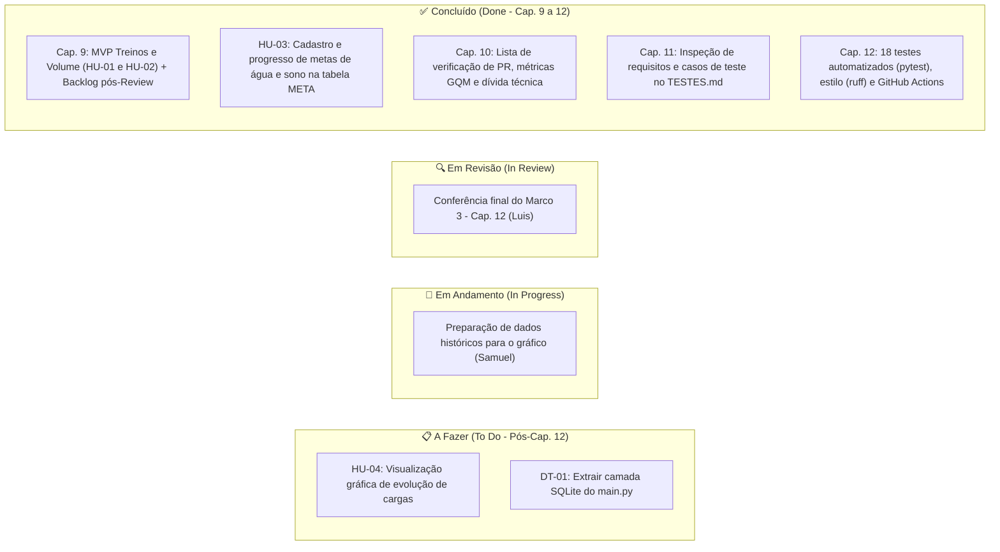

# Quadro de Tarefas (Kanban) — Até o Capítulo 12 (Marco: Qualidade Verificada)

> **Projeto:** Plataforma de Hábitos Saudáveis e Treinos  
> **Equipe:** Arthur Sidarta, Luis Henrique, Samuel Andrade  
> **Política de WIP (Work in Progress):** Máximo de 1 tarefa ativa em andamento/revisão por integrante.

---

## Visualização Geral (Iteração 3: Capítulos 10, 11 e 12)

---

## Status Detalhado por Tarefa (Escopo até o Cap. 12)

| ID / Capítulo | Tarefa | Responsável | Estimativa | Status | Artefato / Evidência no Repositório |
| :--- | :--- | :--- | :---: | :---: | :--- |
| `HU-01` / `HU-02` | Fluxo principal de treinos, validação (`400`) e cálculo de volume | Equipe | 5 pts | **Concluído (Done)** | `main.py`, `ITERACOES.md` (Review Parcial - Cap. 9) |
| `HU-03` | Implementar metas diárias de água e sono na tabela `META` | Arthur Sidarta | 3 pts | **Concluído (Done)** | `CA-03.1` a `CA-03.3` (`POST /api/metas` em `main.py`) |
| `Cap. 10` | Checklist de revisão de código, template de PR e métricas GQM | Luis Henrique | 2 pts | **Concluído (Done)** | `CONTRIBUTING.md`, `.github/pull_request_template.md` e `PROCESSO.md` |
| `Cap. 10` | Mapeamento de dívida técnica (5 campos + estimativa em pontos) | Samuel Andrade | 1 pt | **Concluído (Done)** | Seção "Dívidas Técnicas Registradas" em `ITERACOES.md` (`DT-01` a `DT-03`) |
| `Cap. 11` | Inspeção de requisitos e estratégia de testes com partições e valores limite | Samuel Andrade | 2 pts | **Concluído (Done)** | `TESTES.md` (4 níveis, omissões e casos `TC-01` a `TC-03`) e `Requisitos.md` |
| `Cap. 12` | Testes automatizados de unidade (`calcular_volume`) e integração da API (`pytest`) | Arthur Sidarta | 3 pts | **Concluído (Done)** | `tests/test_unidade.py` e `tests/test_api_treinos.py` (18 testes passando) |
| `Cap. 12` | Verificador de estilo (`ruff`) e Integração Contínua no GitHub Actions | Luis Henrique | 2 pts | **Concluído (Done)** | `.github/workflows/verificacao.yml` e `requirements-dev.txt` |
| `Cap. 12` | Atualizar `TESTES.md` vinculando cada `TC` ao teste automatizado ou manual | Samuel Andrade | 1 pt | **Em Revisão (In Review)** | Seção "5. Automação e Integração Contínua" no `TESTES.md` |
| `HU-04` | Preparar agregação de cargas por data para os gráficos de evolução | Samuel Andrade | 2 pts | **Em Andamento (In Progress)** | Planejado para fechar a `HU-04` na sequência |
| `DT-01` | Pagar dívida técnica: extrair consultas SQLite do `main.py` para módulo próprio | Arthur Sidarta | 2 pts | **A Fazer (To Do)** | Item técnico reservado no backlog (`ITERACOES.md`) |

---

## Resumo dos Marcos até Aqui

- **Marco 1 (Encontro 5):** Escopo, `Descoberta.md`, `Requisitos.md` e protótipo validado. *(Concluído)*
- **Marco 2 (Encontro 9 — Review Parcial):** Modelagem (`PROJETO.md`), Arquitetura (`ARQUITETURA.md`), Contrato (`contrato/`) e fluxo principal funcionando (`HU-01` e `HU-02`). *(Concluído)*
- **Marco 3 (Encontro 12 — Qualidade Verificada):**
  - **Cap. 10:** Qualidade de processo/produto, checklist de revisão, métricas GQM e dívida técnica. *(Concluído)*
  - **Cap. 11:** Verificação e validação, inspeção de requisitos e casos de teste no `TESTES.md`. *(Concluído)*
  - **Cap. 12:** Suíte de 18 testes automatizados (`pytest`), verificador de estilo (`ruff`) e Integração Contínua (`.github/workflows/verificacao.yml`). *(Concluído)*
