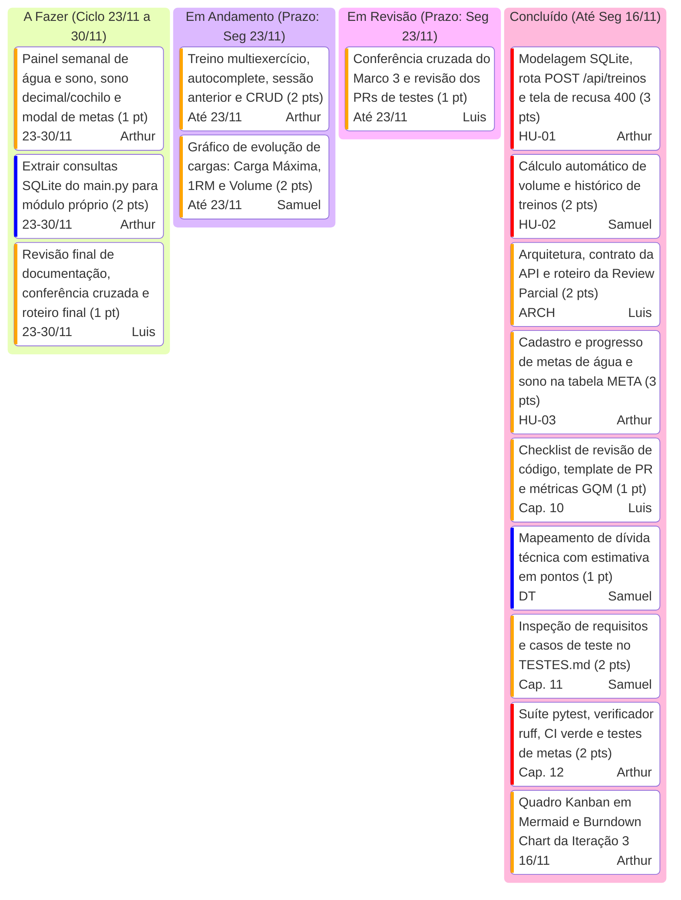

# Quadro de Tarefas (Kanban)

> **Projeto:** Plataforma de Hábitos Saudáveis e Treinos  
> **Equipe:** Arthur Sidarta, Luis Henrique, Samuel Andrade  
> **Cadência de Prazos:** Ciclos semanais de **segunda-feira a segunda-feira** (início e encerramento dos prazos toda segunda-feira; tarefas atualmente em andamento/revisão têm prazo até **segunda-feira, 23/11/2026**).  
> **Classificação por Pontos e Capacidade Semanal:** A equipe avalia cada tarefa antes do ciclo e a classifica em pontos de esforço (`1 pt` = ajuste/revisão, `2 pts` = funcionalidade ou refatoração média, `3 pts` = funcionalidade ponta a ponta com banco + API + UI), mantendo a meta de **2 a 3 pontos por semana** no planejamento.  
> **Política de WIP (Work in Progress):** Máximo de 1 tarefa ativa em andamento/revisão por integrante.  
> **Fonte do diagrama:** [`diagrams/quadro-tarefas.mmd`](diagrams/quadro-tarefas.mmd)

---

## Atualização Semanal (Apresentação 19/11 — Cap. 15 e 16)

> **Regra de prazo semanal:** Toda segunda-feira marca o fechamento do ciclo anterior e o início do próximo ciclo.

### O que passou no último ciclo (encerrado em Segunda 16/11)

- **Fechamento da Iteração 3 (Marco: Qualidade Verificada):**
  - Integração completa da `HU-03` (metas diárias de água e sono) e da suíte de testes automatizados (`pytest`) com verificador de estilo (`ruff`) e CI verde no GitHub Actions (`PR #14` e `PR #16` mesclados na `main`).
  - Expansão da suíte de testes de integração HTTP, contrato JSON de metas diárias (`CA-03.1` a `CA-03.3`) e planejamento semanal de entregas (`PR #15` e `PR #17` abertos para revisão).
  - Conversão do quadro de tarefas para Mermaid `kanban` (`diagrams/quadro-tarefas.mmd`) e criação do **Burndown Chart** da Iteração 3 (`diagrams/burndown-iteracao3.mmd` e `ITERACOES.md`).

### Em andamento / revisão agora (Ciclo atual: Seg 16/11 a Seg 23/11)

- **`DT-03` (Arthur Sidarta — Prazo: Seg 23/11):** evolução do registro de treinos para múltiplos exercícios, busca com autocomplete, recuperação da última sessão e operações de editar/excluir treino.
- **`HU-04` (Samuel Andrade — Prazo: Seg 23/11):** gráfico de evolução de exercícios com seletor de métricas (**Carga Máxima**, **1RM Estimado** por Epley e **Volume Total**), filtros de período (`1M`, `3M`, `6M`, `Tudo`) e tooltips interativos.
- **`Cap. 12` (Luis Henrique — Prazo: Seg 23/11):** conferência cruzada final do Marco 3 (`TESTES.md`) e revisão/merge dos PRs abertos de testes.

### Próximo ciclo (A Fazer: Seg 23/11 a Seg 30/11)

- **`HU-03+` (Arthur Sidarta — 23/11 a 30/11):** painel gráfico semanal de hidratação e sono (7 dias), registro decimal de sono com opção de cochilo, desfazer hidratação e modal de configuração de metas.
- **`DT-01` (Arthur Sidarta — 23/11 a 30/11):** extrair a camada de persistência SQLite do `main.py` para módulo próprio.
- **`Cap. 16` (Luis Henrique — 23/11 a 30/11):** revisão final da documentação (`PROJETO.md`, `ARQUITETURA.md`, `ITERACOES.md`) e roteiro da Review Final.

---

## Histórico de Atualização do Quadro

- **2026-09-17 (Iteração 1):** Criação do quadro com os itens de modelagem (`PROJETO.md`), diagramas e protótipo navegável.
- **2026-10-08 (Iteração 2):** Adoção do limite de WIP (1 tarefa por integrante) e acompanhamento da implementação de `HU-01` e `HU-02` para a Review Parcial.
- **2026-11-05 (Iteração 3):** Movimentação de `HU-01`/`HU-02` para Concluído, inclusão de `HU-03` e tarefas de qualidade e testes (Capítulos 10 a 12).
- **2026-11-19:** Organização dos prazos semanais de segunda-feira a segunda-feira (`16/11 -> 23/11 -> 30/11`) e atualização do Kanban Mermaid para a apresentação dos Capítulos 15 e 16.
